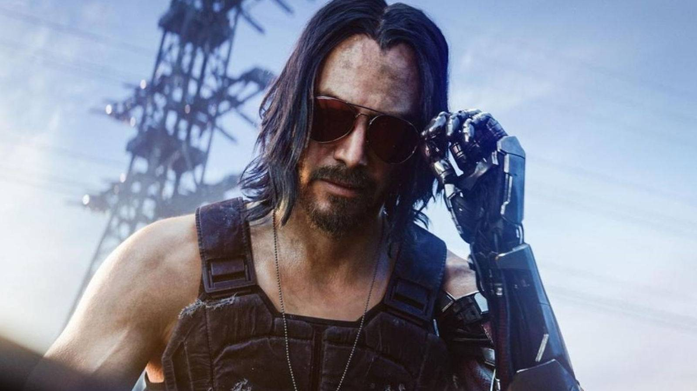

# Johnny Silverhand: The Engram

Интерактивный фан-сайт о Джонни Сильверхенде и вселенной Cyberpunk 2077. Проект объединяет биографию, арсенал, музыкальный плеер SAMURAI, виртуальный POSIX-терминал с небольшой загадкой и экспериментальный CRT-режим.



> Это неофициальный некоммерческий фан-проект, не связанный с CD PROJEKT RED и не одобренный ею. Права на Cyberpunk 2077 и связанные материалы принадлежат CD PROJEKT S.A. Музыка SAMURAI исполнена группой Refused; права на композиции и записи принадлежат соответствующим правообладателям.

## Что уже есть

- Главная, биография, энграмма, арсенал и закрытый раздел с адаптивной вёрсткой.
- Плеер пяти треков SAMURAI: переключение, перемотка и таймер `M:SS.t`. Музыка не обрывается при закрытии плеера: в навбаре остаётся мини-плеер.
- Интерактивный терминал с настоящей виртуальной структурой каталогов, файлами из репозитория, POSIX-правами, пользователями и группами.
- Терминальная загадка: публичные архивы содержат данные для входа в закрытый контур. README намеренно не раскрывает пароль.
- Два взгляда на один архив. По умолчанию сайт — официальная запись. Вход как Сильверхенд включает «взгляд Джонни»: по всему сайту появляются его пометки маркером, зачёркивания и наклейки, а также открывается блок о том, что на самом деле произошло в башне Arasaka в 2023 году (по настольному канону Cyberpunk).
- Локальные изображения, обложки и MP3 без hotlink-зависимостей в реестре `assets.ts`.
- Настройки шума, scanlines, курсора, анимаций и boot sequence с сохранением в `localStorage`.
- Режим производительности для слабых устройств: включается сам по объёму памяти и числу ядер, убирает зерно, размытие, тени и декоративные анимации.
- Адаптация от телефонов 320 px (в том числе горизонтально) до 2K, 4K и ультрашироких мониторов: на больших экранах вся вёрстка масштабируется вместе с экраном. Картинки отдаются в WebP, на телефонах в уменьшенных копиях.
- CRT-режим в двух вариантах: лёгкий CSS-слой (сканлайны, фосфорная маска, виньетка, мерцание) и экспериментальный — WebGL-шейдер и SVG-деформация экрана с согласованным курсором.

## Стек

| Слой | Технология |
|---|---|
| UI | React 19 |
| Сборка | Vite |
| Типизация | TypeScript 5.8 |
| Пакетный менеджер | Bun |
| Стилизация | `styles/main.css` (токены, фирменные компоненты, анимации) и Tailwind CSS v4 в локальной сборке для раскладки |
| Эффекты | CSS-анимации, WebGL, SVG filters, `use-scramble` |
| Иконки | `lucide-react` |
| Деплой | GitHub Actions → Cloudflare Pages |

## Структура проекта

```text
.
├── index.html                       # Точка монтирования
├── index.tsx                        # Точка входа и SettingsProvider
├── styles/main.css                  # Дизайн-токены и все глобальные стили
├── App.tsx                          # Секции, оверлеи и classified-состояние
├── assets.ts                        # Реестр локальных изображений, обложек и музыки
├── assets/                          # Изображения и обложки
├── music/                           # MP3-файлы SAMURAI
├── components/
│   ├── Terminal.tsx                 # Shell, история, completion и авторизация
│   ├── CrtOverlay.tsx               # Лёгкий CRT: CSS-слои без WebGL
│   ├── CrtShader.tsx                # Экспериментальный CRT/WebGL-слой + SVG-деформация
│   ├── Samurai.tsx                  # Музыкальный экран и HTMLAudioElement-плеер
│   ├── SettingsModal.tsx            # Настройки эффектов
│   └── ...
├── context/
│   ├── SettingsContext.tsx          # Настройки → localStorage
│   └── PlayerContext.tsx            # Единый аудиоплеер и список треков
├── terminal/
│   ├── filesystem.ts                # Сборка VFS из реальных файлов и медиа
│   ├── metadata.ts                  # owner, group, mode и media metadata
│   ├── users.ts                     # Пользователи и группы
│   ├── types.ts                     # Типы VFS
│   └── files/                       # Текстовое содержимое виртуальных файлов
└── .github/workflows/
    └── pages-deployment.yaml        # Release/tag deploy в Cloudflare Pages
```

## Терминал

Терминал работает поверх клиентской VFS, а не над файловой системой устройства. Текстовые документы автоматически импортируются из `terminal/files/**/*.txt`; изображения и музыка из `assets/` и `music/` отображаются в `/srv/silverhand`. Расширение `.txt` в виртуальных путях обычно скрывается, поскольку POSIX не определяет тип файла по расширению. Исключения `target.txt` и `incident.txt` оставлены частью загадки.

Для каждого узла заданы владелец, группа и mode. Проверки `r`, `w` и `x` реально применяются к `cat`, навигации и изменяющим командам. Изменения, созданные внутри терминальной сессии, существуют только до перезагрузки страницы; прогресс авторизации хранится отдельно в `localStorage`.

Полезная последовательность для знакомства:

```shell
help
id
tree /
cd /archives/public
ls -l
cat target.txt
stat incident.txt
login silverhand
```

Поддерживаются `help`, `id`, `groups`, `pwd`, `ls`, `tree`, `cd`, `cat`, `file`, `stat`, `touch`, `mkdir`, `write`, `chmod`, `rm`, `login`, `logout`, `whoami`, `clear`, `boot` и `exit`. `Tab` дополняет команды и пути, стрелки вверх/вниз перемещаются по истории.

Метаданные и особые права добавляются в `terminal/metadata.ts`. Новый публичный документ достаточно создать в `terminal/files/`: каталоги и базовые метаданные будут построены автоматически через `import.meta.glob`.

## Медиа и плеер

`assets.ts` — единая точка доступа к локальным изображениям, обложкам и MP3. Плеер использует обычный `HTMLAudioElement`; аудио сейчас попадает в сборку Pages целиком. Следующий инфраструктурный шаг — вынести музыку в Cloudflare R2 и оставить в приложении URL-реестр, чтобы уменьшить размер релиза и использовать HTTP Range-запросы.

Все материалы используются только в рамках некоммерческого фан-проекта. Указание правообладателей не заменяет разрешение или лицензию на распространение файлов.

## CRT-режим и производительность

CRT включается в настройках в двух вариантах:

- **CRT DISPLAY** — лёгкий режим (`CrtOverlay.tsx`). Один статичный слой с фосфорной маской и виньеткой плюс два слоя, анимирующие только `opacity` и `transform` (мерцание сканлайнов и бегущая полоса). Такие анимации выполняет компоновщик без перерисовки страницы, поэтому нагрузка минимальна. Скролл и системный курсор работают как обычно, при `prefers-reduced-motion` анимации отключаются.
- **CRT GEOMETRY WARP** (блок `Experimental`, доступен только при включённом CRT) — полноэкранный WebGL-шейдер и SVG barrel displacement, который искривляет всю страницу. SVG-фильтр заставляет браузер заново растрировать весь DOM при каждом скролле и анимации, поэтому режим крайне тяжёлый: в headless-замере он выдавал примерно в 15 раз меньше кадров, чем лёгкий. Оставлен как демонстрационный.

## Локальный запуск

Требуется установленный [Bun](https://bun.sh/).

```bash
bun install
bun run dev
```

Проверка типов и production-сборки:

```bash
bunx tsc --noEmit
bun run build
bun run preview
```

## Ветки и релизы

- `dev` — рабочая ветка для разработки.
- `main` — проверенное состояние, из которого выпускаются релизы.

Обычный поток изменений:

```text
feature work → dev → pull request → main → tag/release → Cloudflare Pages
```

Деплой не запускается при обычном push в `dev` или `main`. Единственный триггер — push тега вида `v*`. Workflow `Release` собирает проект, отправляет `dist/` в production-ветку `main` проекта Cloudflare Pages и после успешного деплоя создаёт GitHub Release с заметками.

### Changelog

`CHANGELOG.md` и заметки к релизам генерируются [git-cliff](https://git-cliff.org) (конфиг — `cliff.toml`) из Conventional Commits: `feat` → «Новое», `fix` → «Исправления», `docs`, `refactor`, `ci` и т.д. Коммиты, не соответствующие формату, и merge-коммиты в changelog не попадают, поэтому формат сообщений коммитов важен.

### Выпуск релиза

```bash
# 1. На dev: зафиксировать changelog новой версии и влить его через PR
git switch dev
bun run changelog -- --tag v1.0.2
git commit -am "chore(release): v1.0.2"
git push origin dev            # затем PR dev → main и merge

# 2. На main: поставить тег — он запускает деплой и создание GitHub Release
git switch main && git pull --ff-only
git tag -a v1.0.2 -m "v1.0.2"
git push origin v1.0.2

# 3. Вернуть dev к main
git switch dev && git merge --ff-only main && git push origin dev
```

Если секцию changelog забыли сгенерировать, релиз всё равно выйдет (заметки строятся из истории), но workflow выдаст предупреждение.

Для GitHub Actions необходимы секреты `CLOUDFLARE_API_TOKEN` и `CLOUDFLARE_ACCOUNT_ID`.

## Дизайн

Визуальная идея — панк-зин о мёртвом рокере, который читают через сбоящий биочип: плакатная типографика, красный как ведущий цвет, «бумажные» секции досье среди тёмных, жёлтая сигнальная лента. Сам чип Relic красный, поэтому раздел энграммы тоже красный; циан остался только для редкого «сбоя Relic».

```css
--ink: #0a0908;     /* фон */
--bone: #e9e3d3;    /* бумага и основной текст */
--red: #ff003c;     /* ведущий акцент */
--yellow: #fcee0a;  /* сигнальная лента, пометки */
--cyan: #00f0ff;    /* только «сбой Relic» */
```

Шрифты с поддержкой кириллицы: Oswald — заголовки, Golos Text — основной текст, JetBrains Mono — подписи, данные и терминал, Caveat — пометки Джонни. Они подключены как пакеты `@fontsource/*` и собираются вместе с сайтом, без обращения к Google Fonts.

## Правообладатели

Cyberpunk 2077, его мир, персонажи, названия и связанные визуальные материалы принадлежат CD PROJEKT S.A. Образ виртуальной группы SAMURAI и связанные произведения используются в контексте Cyberpunk 2077; музыкальные партии SAMURAI исполнены Refused. Все соответствующие товарные знаки, композиции, фонограммы и изображения принадлежат их правообладателям.

Проект создан в образовательных и демонстрационных целях и не предназначен для продажи или извлечения прибыли. Если вы являетесь правообладателем и хотите обсудить использование материала, откройте issue в репозитории.
